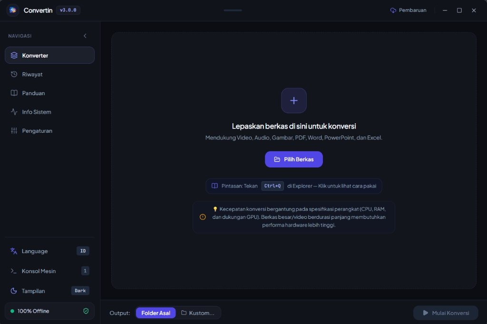
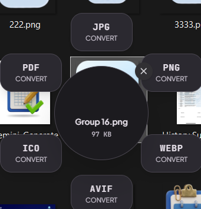
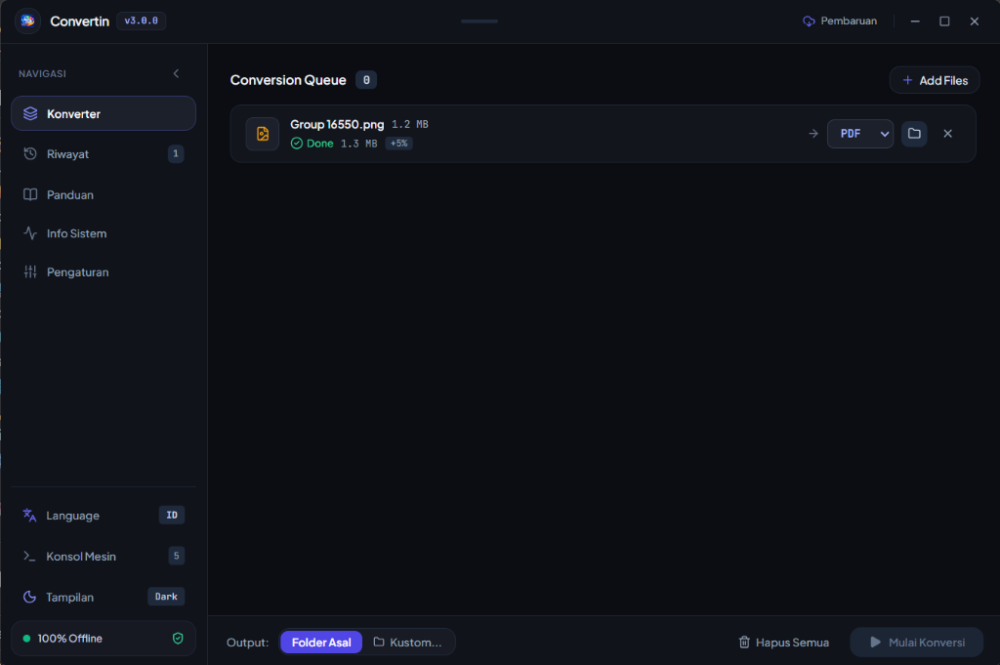

  
  <h1>Convertin</h1>
  
<strong>Aplikasi Pengubah Format Berkas & Media 100% Gratis, Cepat, dan Sepenuhnya Offline untuk Windows</strong>

  

    
    
    
    
  

  

    
  

---

## 💡 Mengapa Memilih Convertin?

Sering merasa khawatir saat mengonversi dokumen rahasia, video, atau foto penting ke website konverter online karena takut data bocor atau diunggah ke cloud? **Convertin adalah solusinya!**

Convertin adalah aplikasi desktop Windows yang memproses semua berkas **100% secara lokal** di komputer Anda. Tanpa koneksi internet, tanpa batasan ukuran file, tanpa iklan, dan privasi Anda terjamin 100% aman karena berkas tidak pernah dikirim ke mana pun.

---

## 📸 Tampilan Antarmuka Asli (Screenshots v3.0.0)

  <h3>✨ 1. Halaman Utama — Bersih, Elegan & Ramah Mata</h3>
  
Tersedia info tips spesifikasi perangkat, drag and drop instan, quick switch bahasa, dan status offline.

  
     

  <h3>⚡ 2. Pintasan Roda Radial (Ctrl + Q) Langsung di Windows Explorer</h3>
  
Ubah format seketika tanpa membuka aplikasi. Klik file apa saja di Explorer lalu tekan <code>Ctrl + Q</code>.

  
     

  <h3>📊 3. Antrean Konversi Cerdas (Smart Conversion Queue)</h3>
  
Menampilkan status proses, selisih ukuran hasil konversi, serta counter antrean aktif yang akurat.

  

---

## 🌟 Fitur Unggulan

* **🔒 100% Offline & Privasi Terjaga:** Bekerja mandiri tanpa koneksi internet. Sangat aman untuk dokumen perusahaan, tugas kampus, dan foto pribadi.
* **⚡ Menu Donut Radial (`Ctrl + Q`):** Buka Windows Explorer, klik berkas Anda, tekan `Ctrl + Q`, lalu klik format target. File langsung terkonversi otomatis di folder yang sama!
* **📂 Konversi Banyak Berkas Sekaligus (Batch):** Seret puluhan file sekaligus dan ubah semua ke format target hanya dengan satu klik.
* **🖥️ Akselerasi Hardware GPU:** Mendukung GPU NVIDIA (NVENC) serta multi-core processor untuk proses transcode video dan gambar beresolusi tinggi yang super cepat.
* **🔎 Riwayat Konversi & Pencarian Cepat:** Dilengkapi fitur pencarian nama file, pagination, serta perbandingan ukuran file sebelum vs sesudah konversi.
* **📐 Sidebar Interaktif:** Sidebar navigasi modern yang bisa diperlebar (*expand*) atau diperkecil (*minimize*) dengan animasi transisi yang halus.
* **🌐 Pilihan Bahasa:** Mendukung Bahasa Indonesia dan English yang bisa diganti kapan saja secara instan.
* **🔄 Pembaruan Otomatis (OTA):** Notifikasi update langsung di dalam aplikasi saat versi baru tersedia di GitHub.
* **🏪 Segera Hadir di Microsoft Store:** Sedang dalam tahap rilis resmi di Windows Store.

---

## 📁 Beragam Format yang Didukung

| Kategori | Format yang Didukung |
| :--- | :--- |
| **🎬 Video** | MP4, MKV, MOV, WebM, AVI, GIF Animasi |
| **🎵 Audio** | MP3, WAV, FLAC, AAC, OGG, M4A, Ekstraksi Audio dari Video |
| **🖼️ Gambar** | PNG, JPG, JPEG, WEBP, AVIF, ICO, BMP, TIFF, SVG Vektor |
| **📄 Dokumen & Office** | Word (DOCX), Excel (XLSX), PowerPoint (PPTX) ke PDF, dan PDF ke Gambar/Dokumen |

---

## 🚀 Cara Mudah Menggunakan

1. **Unduh Installer:** Unduh berkas instalasi terbaru di [GitHub Releases](https://github.com/naufalt/convertin/releases/latest) (pilih `Convertin-Setup-v3.0.0-x64.exe`).
2. **Pasang di Komputer:** Buka installer dan tentukan folder instalasi yang Anda inginkan (secara bawaan terpasang rapi di `Program Files`).
3. **Mulai Konversi:**
   * **Cara 1 (Di Aplikasi):** Buka Convertin, tarik berkas Anda ke layar, pilih format, lalu klik **Mulai Konversi**.
   * **Cara 2 (Paling Cepat):** Di folder mana saja di komputer Anda, klik berkas yang ingin diubah, tekan keyboard **`Ctrl + Q`**, dan klik format tujuan pada roda yang muncul!

---

## ⌨️ Pintasan Tombol Pintar

* **`Ctrl + Q`** atau **`Alt + C`**: Memunculkan roda konversi instan di posisi kursor mouse Anda pada Windows Explorer.
* **`Esc`**: Menutup roda konversi.

---

## 💚 Dukung Pengembang (Buy Me a Matcha)

Convertin adalah proyek independen dan sumber terbuka (*open-source*) yang dibuat gratis tanpa iklan untuk membantu produktivitas sehari-hari.

Jika Convertin membantu mempermudah pekerjaan atau tugas Anda, Anda dapat memberikan apresiasi dan mentraktir secangkir Matcha hangat untuk pengembang melalui:

👉 **[Traktir Matcha di Saweria (saweria.co/naufalt)](https://saweria.co/naufalt)** 🍵

Apresiasi Anda sangat berharga untuk terus merawat dan mengembangkan fitur-fitur baru di Convertin!

---

## 👨‍💻 Pengembang & Lisensi

* Dibuat dan dikembangkan oleh **Naufaal Muhammad** ([@naufalt](https://github.com/naufalt)).
* Proyek ini 100% sumber terbuka di bawah naungan [Lisensi MIT](LICENSE). Bebas digunakan untuk keperluan pribadi maupun komersial.
