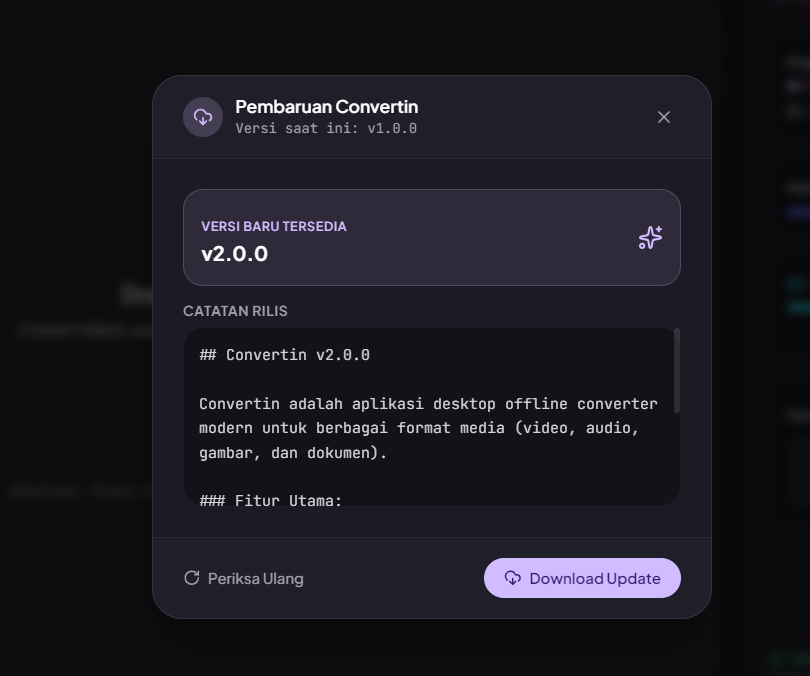
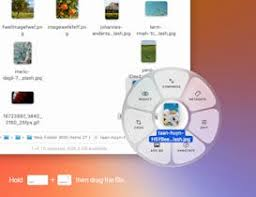

  
  <h1>Convertin</h1>
  
<strong>Aplikasi Pengubah Format Berkas & Media 100% Gratis, Cepat, dan Sepenuhnya Offline untuk Windows</strong>

  

    
    
    
    
  

  

    
  

---

## 💡 Mengapa Memilih Convertin?

Apakah Anda sering merasa ragu saat mengonversi dokumen rahasia, video, atau foto berharga ke situs web konverter online karena takut data diunggah ke internet? **Convertin dibuat untuk menyelesaikan masalah tersebut!**

Convertin adalah aplikasi desktop Windows yang bekerja **100% secara lokal** di laptop atau PC Anda. Tanpa koneksi internet, tanpa kuota terbuang, tanpa iklan, dan privasi Anda terjamin 100% aman karena berkas Anda tidak pernah meninggalkan komputer Anda.

---

## 📸 Tampilan Antarmuka (Screenshots)

  <h3>✨ Antarmuka Modern, Bersih & Ramah Mata (Soft Light & Dark Mode)</h3>
  
    
  <h3>⚡ Konversi Kilat Langsung dari Windows Explorer (Shortcut Ctrl + Q)</h3>
  

---

## 🌟 Fitur Utama untuk Anda

* **🔒 100% Offline & Privasi Terjaga:** Semua proses berjalan di komputer sendiri. Aman untuk dokumen kantor, tugas kuliah, dan foto/video pribadi.
* **⚡ Konversi Seketika dengan `Ctrl + Q`:** Cukup klik berkas apa saja di Windows Explorer, tekan `Ctrl + Q`, pilih format tujuan pada menu donat yang muncul, dan selesai! Tidak perlu repot buka aplikasi dulu.
* **📂 Konversi Massal (Batch Mode):** Punya 50 foto atau video sekaligus? Tinggal tarik & lepas (*drag and drop*), pilih format target dalam satu klik, lalu proses sekaligus.
* **🖥️ Akselerasi Hardware (GPU):** Mendukung kartu grafis NVIDIA (NVENC) dan multi-core prosesor modern agar konversi video resolusi tinggi berjalan sangat cepat.
* **🔎 Riwayat & Pencarian Berkas:** Tersedia tab Riwayat yang rapi dilengkapi kolom pencarian dan pembagian halaman (*pagination*), lengkap dengan selisih ukuran berkas sebelum dan sesudah konversi.
* **🌐 Dukungan Multi-Bahasa:** Tersedia dalam **Bahasa Indonesia** dan **English**.
* **🌙 Tampilan Lembut (Eye-Friendly):** Mode Terang yang tidak silau dan Mode Gelap yang nyaman untuk bekerja di malam hari.
* **🔄 Pembaruan Otomatis (OTA Update):** Notifikasi pembaruan aplikasi langsung dari dalam aplikasi dengan satu klik pasang.
* **🏪 Segera Hadir di Microsoft Store:** Sedang dalam proses rilis resmi di Windows Store.

---

## 📁 Beragam Format yang Didukung

| Kategori | Format yang Didukung |
| :--- | :--- |
| **🎬 Video** | MP4, MKV, MOV, WebM, AVI, GIF Animasi |
| **🎵 Audio** | MP3, WAV, FLAC, AAC, OGG, M4A, Ekstraksi Audio dari Video |
| **🖼️ Gambar** | PNG, JPG, JPEG, WEBP, AVIF, ICO, BMP, TIFF, SVG Vektor |
| **📄 Dokumen & Office** | Word (DOCX), Excel (XLSX), PowerPoint (PPTX) ke PDF, dan PDF ke Gambar/Dokumen |

---

## 🚀 Cara Mulai Menggunakan

1. **Unduh Installer:** Unduh berkas instalasi terbaru di halaman [GitHub Releases](https://github.com/naufalt/convertin/releases/latest) (pilih `Convertin-Setup-v3.0.0-x64.exe`).
2. **Pasang di Komputer:** Buka installer dan ikuti petunjuk pemasangan (secara default akan terpasang rapi di `Program Files`).
3. **Mulai Konversi:**
   * **Cara 1:** Buka aplikasi Convertin, tarik berkas Anda ke area konversi, pilih format, lalu klik **Mulai Konversi**.
   * **Cara 2 (Paling Cepat):** Di folder mana saja di komputer Anda, klik berkas yang ingin diubah, tekan keyboard **`Ctrl + Q`**, dan klik format yang diinginkan!

---

## ⌨️ Pintasan Tombol Berguna

* **`Ctrl + Q`** atau **`Alt + C`**: Menampilkan menu cepat Radial tepat di posisi kursor mouse Anda di Windows Explorer.
* **`Esc`**: Menutup menu cepat kapan saja.

---

## 💚 Dukung Pengembang (Buy Me a Matcha)

Convertin adalah proyek independen dan sumber terbuka (*open-source*) yang dirancang untuk membantu produktivitas masyarakat secara cuma-cuma tanpa iklan yang mengganggu.

Jika Convertin bermanfaat mempermudah pekerjaan atau tugas sehari-hari Anda, Anda dapat memberikan apresiasi dan traktir secangkir Matcha hangat untuk pengembang melalui:

👉 **[Traktir Matcha di Saweria (saweria.co/naufalt)](https://saweria.co/naufalt)** 🍵

Dukungan Anda sangat berarti untuk pemeliharaan server, pembaruan fitur, dan pengembangan aplikasi bermanfaat lainnya!

---

## 👨‍💻 Pengembang & Lisensi

* Dikembangkan dengan sepenuh hati oleh **Naufaal Muhammad** ([@naufalt](https://github.com/naufalt)).
* Proyek ini 100% sumber terbuka (*open-source*) di bawah naungan [Lisensi MIT](LICENSE). Bebas digunakan untuk keperluan pribadi maupun profesional.
